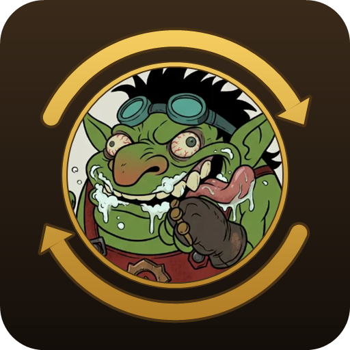

<p align="center"></p>

# Bot'tar Sync

An addon for WoW Forever (the `_forever_` client, 1.60.x) that shares the
characters of every guild member with the addon, and writes the whole guild
into a file for the guild's Discord bot, Bot'tar, together with what the
guild's other addons share.

- **Every character.** Each client reads its own character: name, realm,
  level, class, race, sex and faction.
- **Who plays each character.** A guild member whose account has no Discord
  username yet is asked for it, in a box with an Accept button, a little
  after logging in or joining the guild: the account's unique username, not
  the display name nor a server nickname. The guild window's **My data** button (at
  the bottom right of its Chat and Roster tabs, right of Invite Member and
  Guild Settings) opens a window to change it and to tick which characters
  are mains; the others are alts, and a player may have several mains. The
  name and the mains belong to the WoW account: every character of the
  account carries them, and characters on another account that go by the
  same Discord name count as the same player. From the same window a player
  adds any other character of the guild that is nobody's yet: it counts as
  theirs at once, pending, and when it logs in it is asked whether it is
  theirs. Accepting makes only that character theirs, not the rest of its
  WoW account; one that already has another player's name stays theirs.
- **The officers manage every player.** The guild master and the members
  whose rank has the game's "Has officer privileges" find any player in My
  data, by their username or any character of theirs (or with a click on a
  member in the Statistics window's list), and change their username,
  mains and characters, also for members without Bot'tar Sync. What they set
  counts at once and prevails over what the player says.
- **The guild in numbers.** A **Statistics** button on the guild window's
  title bar, left of its minimize button, opens a window beside it:
  how many mains, alts and bank characters there are (bank characters by
  Guild Bank Alts' bank ranks; members without Bot'tar Sync count as mains),
  a bar of the classes (and of the chosen class's specializations, from
  Guild Builds) and the members by level, with the list of the members
  beside them. A click on any number filters the list. The roster itself lists
  everyone, as the game does (the game blocks changing notes and ranks from
  rows an addon drew); a member's tooltip there always shows, with their
  player's Discord username, mains and alts.
- **The Guild Info tab.** The message of the day shows whole, with no
  arrows to scroll it, and under it a Discord panel: the guild's Discord
  link, which the guild master and the officers change (its Edit link) and
  anyone copies (its copy button selects it, for Ctrl+C: the game lets no
  addon write to the clipboard). The guild information takes the rest of
  the column, down to the bottom.
- **What the other addons share goes into the file too.** Each guild addon
  shares its own part, and Bot'tar Sync reads it from them when it writes
  the file: professions and recipes from Guild Professions & Recipes;
  talents (both specs with dual spec), the items worn and the item level
  from Guild Builds, as each member chooses to share them there.
- **Automatic sharing.** The data goes to the rest of the guild through hidden
  addon messages, which never appear in any chat window. When you log in, a
  guild member who is online sends you whatever you are missing, so as long as
  someone with the addon is online, everyone ends up with the same data.
- **The file for the bot.** When you log out or reload the interface, the
  addon writes everything it knows, plus the guild roster (rank, note, level,
  last time online, also for members without the addon), as JSON into its
  saved variables file. Bot'tar reads it from the bot admin's computer. The
  format and readers for Node.js and Python are in
  [Bot/README.md](https://github.com/Nedyar/BottarSync/blob/main/Bot/README.md),
  in the GitHub repository (they are not part of the addon's package).
- **Every client language.** The addon's texts are in English, German, Spanish
  (EU and Latin America), French, Italian, Korean, Portuguese (Brazil, also
  used by Portugal's client), Russian and Chinese (simplified and
  traditional).
- **The guild's other addons come with it.** Guild Professions & Recipes
  (crafting orders and who knows each recipe), Guild Bank Alts (the guild
  bank kept on characters) and Guild Builds (talent builds and gear sets in
  the guild roster) are separate addons, which anyone can install on their
  own. The guild also uses KinFolk, a guild hub addon by another author.
  The CurseForge app installs all four with Bot'tar Sync, so a
  guild member only needs this one. In game Bot'tar Sync loads after them,
  but runs without them: a member who turns one off keeps sharing their
  characters, and a file written without one goes without its part
  (`/bottar status` says so).
- **From KinFolk to the guild window.** With KinFolk on, KinFolk's window
  gets a button with the guild tabard, left of its close button, that opens
  and closes the game's guild window. A key binding (Key Bindings, AddOns, Bot'tar Sync)
  opens and closes KinFolk too, such as Shift+J while J keeps the game's
  guild window.

## Installing

1. With the CurseForge app, install Bot'tar Sync: the app also installs the
   guild's other addons and **LibGuildSync**, the shared code they all need.
   By hand, copy the `BottarSync`, `LibGuildSync`,
   `GuildProfessionsRecipes`, `GuildBankAlts`, `GuildBuilds` and `KinFolk`
   folders into `World of Warcraft\_forever_\Interface\AddOns\` (Bot'tar
   Sync itself only needs `LibGuildSync`).
2. Log in with each character once, and open each profession window once so
   the addon can read the recipes. Once any character of your account has
   opened a profession's window, your other characters with that profession
   get their recipes without opening anything.

## Commands

| Command | What it does |
|---|---|
| `/bottar` or `/bottar status` | What the addon knows and is doing |
| `/bottar show [name]` | A guild member's data (yours with no name), as the bot gets it, in a window you can copy from |
| `/bottar save` | Write the file for the bot now (reloads the interface) |
| `/bottar export on\|off` | Whether this computer writes the file for the bot (on by default) |
| `/bottar sync` | Ask the guild for missing data now |
| `/bottar language <code>\|auto` | The language of the addon's own texts |
| `/bottar debug` | Show the sync log in the chat |
| `/bottar reset` | Forget the data of your current guild |

## What is shared

The character, and your Discord name with your mains and alts, go to every
guild member who runs the addon; what the other addons share follows their
own settings. The roster data (rank, public note,
last time online) is read by each client from the game, as the guild window
shows it; officer notes are never exported.

## Tests

The tests run outside the game with Lua 5.1, from the addon folder, with
the folders of LibGuildSync (its harness and its files are used), Guild
Professions & Recipes and Guild Builds next to it (the simulated clients run
them too):

```
lua5.1 Tests\run.lua . Tests
```

They load the real files of LibGuildSync, of the two addons and of this one
into simulated clients that talk through a simulated server, and check the
sync, the saved data, the JSON (with the builds read from the game's import
strings, which the tests make in the game's format) and, when Node.js is
installed, the bot's reader on files written the way the game writes them. Another checks the KinFolk button and key
against a stand-in for KinFolk's public pieces, and another the Discord name box, the My data
window and its button, and how a profile travels between the characters of an account and the
guild. Another checks the roster's filters, its tooltips and the Statistics window against a
stand-in for the game's member list, and another the Guild Info tab and the guild's Discord link. One test puts members on the last release
(taken from its git tag) in the same guild as members on this version.

## Releasing

Once the addon has a CurseForge project with this repository's webhook,
CurseForge packages every tagged commit pushed here.

1. Raise `## Version` in `BottarSync.toc` and add that version's entry at
   the top of `CHANGELOG.md`. The tests check that both match. If
   `ANNOUNCE_AS` is set in `Core.lua` (a version tried in game while telling
   the guild it is the last release), set it to nil. While a version with a
   new protocol is tried in game, `trial = true` in the configuration in
   `Core.lua` keeps it on an addon-message prefix of its own, so members on
   the released version are not asked to update yet; set it to `false` for
   the release. The tests print a note while either is on.
2. Commit, tag the commit `v<version>` and push the tag:
   `git push origin v<version>`. A tag containing `beta` or `alpha` makes a
   beta or alpha file instead of a release.
3. CurseForge builds the zip as `.pkgmeta` says: the `BottarSync` folder
   without the tests and without `Bot` (the bot's readers, which CurseForge
   would not accept), with `CHANGELOG.md` as the file's changelog.

## License

MIT. See [LICENSE](LICENSE).
