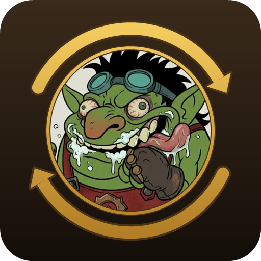

<p align="center"></p>

# Bot'tar Sync

An addon for WoW Forever (the `_forever_` client, 1.60.x) that shares the
characters of every guild member with the addon, and writes the whole guild
into a file for the guild's Discord bot, Bot'tar.

- **Every character.** Each client reads its own character: name, realm, level,
  class, race, sex, faction, item level, equipped items, professions with
  their recipes, and talents (both specs with dual spec).
- **Automatic sharing.** The data goes to the rest of the guild through hidden
  addon messages, which never appear in any chat window. When you log in, a
  guild member who is online sends you whatever you are missing, so as long as
  someone with the addon is online, everyone ends up with the same data.
- **The file for the bot.** When you log out or reload the interface, the
  addon writes everything it knows, plus the guild roster (rank, note, level,
  last time online, also for members without the addon), as JSON into its
  saved variables file. Bot'tar reads it from the bot admin's computer. The
  format and readers for Node.js and Python are in
  [Bot/README.md](https://github.com/Nedyar/BottarSync/blob/main/Bot/README.md),
  in the GitHub repository (they are not part of the addon's package).
- **Every client language.** The addon's texts are in English, German, Spanish
  (EU and Latin America), French, Italian, Korean, Portuguese (Brazil, also
  used by Portugal's client), Russian and Chinese (simplified and
  traditional).
- **The guild's other addons come with it.** Guild Professions & Recipes
  (crafting orders and who knows each recipe) and Guild Bank Alts (the guild
  bank kept on characters) are separate addons, which anyone can install on
  their own. The CurseForge app installs them with Bot'tar Sync, so a guild
  member only needs this one. In game Bot'tar Sync loads after them, but
  runs without them (a member who turns one off keeps sharing their
  characters), and does not read their data yet.

## Installing

1. With the CurseForge app, install Bot'tar Sync: the app also installs the
   guild's other addons and **LibGuildSync**, the shared code they all need.
   By hand, copy the `BottarSync`, `LibGuildSync`,
   `GuildProfessionsRecipes` and `GuildBankAlts` folders into
   `World of Warcraft\_forever_\Interface\AddOns\` (Bot'tar Sync itself only
   needs `LibGuildSync`).
2. Log in with each character once, and open each profession window once so
   the addon can read the recipes. Once any character of your account has
   opened a profession's window, your other characters with that profession
   get their recipes without opening anything.

## Commands

| Command | What it does |
|---|---|
| `/bottar` or `/bottar status` | What the addon knows and is doing |
| `/bottar show [name]` | A guild member's data (yours with no name), as the bot gets it, in a window you can copy from |
| `/bottar save` | Write the file for the bot now (reloads the interface) |
| `/bottar export on\|off` | Whether this computer writes the file for the bot (on by default) |
| `/bottar sync` | Ask the guild for missing data now |
| `/bottar language <code>\|auto` | The language of the addon's own texts |
| `/bottar debug` | Show the sync log in the chat |
| `/bottar reset` | Forget the data of your current guild |

## What is shared

Everything listed above goes to every guild member who runs the addon. The
roster data (rank, public note, last time online) is read by each client from
the game, as the guild window shows it; officer notes are never exported.

## Tests

The tests run outside the game with Lua 5.1, from the addon folder, with
LibGuildSync's folder next to it (its harness and its files are used):

```
lua5.1 Tests\run.lua . Tests
```

They load LibGuildSync's and the addon's real files into simulated clients
that talk through a simulated server, and check the sync, the saved data,
the JSON and, when Node.js is installed, the bot's reader on files written
the way the game writes them. One test puts members on the last release
(taken from its git tag) in the same guild as members on this version.

## Releasing

Once the addon has a CurseForge project with this repository's webhook,
CurseForge packages every tagged commit pushed here.

1. Raise `## Version` in `BottarSync.toc` and add that version's entry at
   the top of `CHANGELOG.md`. The tests check that both match.
2. Commit, tag the commit `v<version>` and push the tag:
   `git push origin v<version>`. A tag containing `beta` or `alpha` makes a
   beta or alpha file instead of a release.
3. CurseForge builds the zip as `.pkgmeta` says: the `BottarSync` folder
   without the tests and without `Bot` (the bot's readers, which CurseForge
   would not accept), with `CHANGELOG.md` as the file's changelog.

## License

MIT. See [LICENSE](LICENSE).
